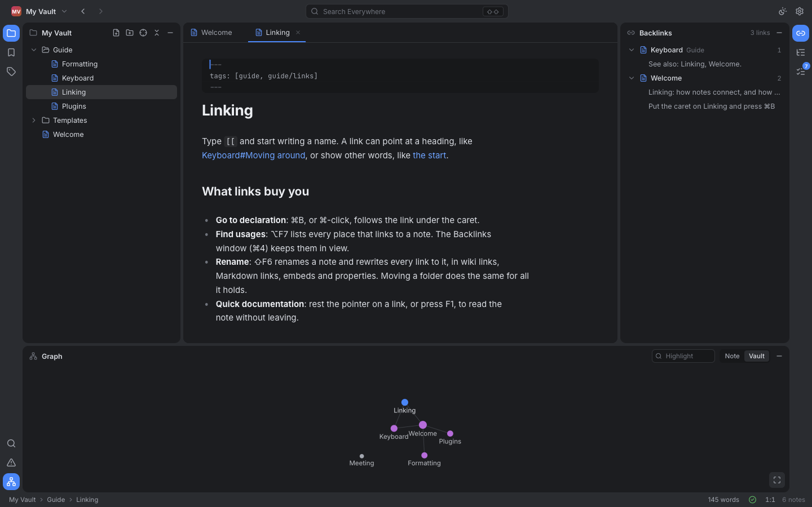

<p align="center">
  
</p>

<h1 align="center">Itztli</h1>

<p align="center">
  <strong>Notes in plain Markdown, linked, at the speed of your keyboard.</strong><br>
  Open source, with the keys and the feel of a JetBrains IDE.
</p>

<p align="center"></p>

## Why Itztli

*Itztli* is obsidian in Nahuatl. It is a notes app for people whose hands know
IntelliJ: **⇧⇧** searches everything, **⇧F6** renames a note and every link to
it, **⌥F7** finds usages, **⌥⏎** offers what can be done here.

Your notes are a folder of Markdown files. There is no account, no database and
no format of its own: what you write is yours, and opens anywhere.

## Features

### Write
- **Live preview**: Markdown shows as what it means, and its markup only where
  you are writing. Or the plain source, with one key.
- Multiple cursors, extend selection, move statement, duplicate, join: the
  IntelliJ editing keys.
- Wiki links, embeds, tags, callouts, tasks, tables, highlights, properties,
  block references, and code blocks in over a hundred languages.
- **Saves by itself, and never over someone else's change**: if the file
  changed on disk while you were typing, you choose, with both side by side.

### Connect
- **Completion** for links, headings and tags, by name or alias, ranked as you
  type.
- **Rename and move without breaking links**: wiki links, Markdown links,
  embeds and properties are rewritten, including the ones that would have
  become ambiguous. You see how many before you do it.
- **Backlinks**, **Find Usages**, quick documentation on hover, a **graph** of a
  note or of everything, and a list of **problems**: every link that leads
  nowhere.
- **Context actions (⌥⏎)**: create the note a link is missing, extract a section
  to its own note, embed instead of linking, inline what is embedded…

### Find
- **Search Everywhere (⇧⇧)**: notes, headings, text and every action.
- **Find in Files (⇧⌘F)**: as you type, ignoring accents unless you type them,
  with regular expressions and a preview.
- Go to note, file, heading or line; recent files; file structure; bookmarks.

### Extend
- **[Plugins](docs/plugins.md)** are a folder with two files, and need no build
  step. They can add commands, tool windows, editor behavior, completions,
  context actions, code block renderers, file viewers, themes and settings.
- Several of Itztli's own features (daily notes, templates, tasks, word count,
  focus mode) are plugins written against the same API.
- **A plugin that comes with a vault never runs on its own**, and one that
  changes is stopped until you review it.

### Work with an assistant
- **An [MCP](#let-an-assistant-use-your-notes) server built in**: Claude Code,
  Claude Desktop, Cursor or any MCP client can search and read your notes, and
  propose changes to them.
- **You approve every change**, seeing the difference first, and everything an
  assistant did is on record.

### Keep
- **Local History**: what every note said before, for 30 days, kept on your
  computer and outside the vault.
- Deleting goes to the system trash, and tells you which links will break.

## Fast

Measured on a vault of 10,000 notes (37 MB), on an Apple Silicon Mac:

|                                             |              |
| ------------------------------------------- | -----------: |
| Read and index every note                   |       160 ms |
| Go to Note, per key                         |      3–10 ms |
| Find in Files, every note read from disk    |        80 ms |
| Backlinks of a note                         |         2 ms |
| Open a note of 10,000 lines (770 KB)        |        80 ms |
| Type in it, per key                         |       2–3 ms |

The index lives in memory and is rebuilt on opening, so it is never out of
date. The app is 13 MB, on the system's own web view and a Rust core.
`cargo bench -p itztli-index` measures the index by itself.

## Keyboard

| Action                          | Shortcut |
| ------------------------------- | -------- |
| Search Everywhere               | ⇧⇧       |
| Find Action                     | ⇧⌘A      |
| Go to Note / File / Heading     | ⌘O / ⇧⌘O / ⌥⌘O |
| Recent Files                    | ⌘E       |
| File Structure                  | ⌘F12     |
| Go to Declaration (on a link)   | ⌘B       |
| Back / Forward                  | ⌘[ / ⌘]  |
| Find Usages                     | ⌥F7      |
| Quick Documentation             | F1       |
| Show Context Actions            | ⌥⏎       |
| Rename / Move / Copy            | ⇧F6 / F6 / F5 |
| Extract to Note                 | ⌥⌘M      |
| Find in Files                   | ⇧⌘F      |
| Extend / Shrink Selection       | ⌥↑ / ⌥↓  |
| Move Statement                  | ⇧⌘↑ / ⇧⌘↓ |
| Insert Template                 | ⌘J       |
| Today's Note                    | ⇧⌘D      |
| Tool windows                    | ⌘1 … ⌘9  |
| Hide All Tool Windows           | ⇧⌘F12    |

Every action is in Find Action and can be given other keys in
Settings → Keymap.

## Let an assistant use your notes

Itztli can share the open vault with an AI assistant: Claude Code, Claude
Desktop, Cursor, VS Code or any [MCP](https://modelcontextprotocol.io) client.
It is off until you turn it on.

Run **Connect an MCP Client…** (⇧⌘A), give it a name and choose what it may do:
**Read**, or **Write**, which lets it propose changes too. Itztli asks you once
more, turns the server on, and shows the client's token, once, next to what to
paste in each assistant.

**Claude Code**, in a terminal:

```sh
claude mcp add --scope user --transport http itztli http://127.0.0.1:7413/mcp --header "Authorization: Bearer <TOKEN>"
```

**Cursor**, in `~/.cursor/mcp.json`:

```json
{
  "mcpServers": {
    "itztli": {
      "url": "http://127.0.0.1:7413/mcp",
      "headers": { "Authorization": "Bearer <TOKEN>" }
    }
  }
}
```

**Claude Desktop** only launches local programs, so it runs Itztli's own
bridge, which opens Itztli in the background if it isn't running. In Claude,
open Settings → Developer → Edit Config, add this to
`claude_desktop_config.json` and restart Claude:

```json
{
  "mcpServers": {
    "itztli": {
      "command": "/Applications/Itztli.app/Contents/MacOS/itztli",
      "args": ["mcp-bridge", "--port", "7413"],
      "env": { "ITZTLI_MCP_TOKEN": "<TOKEN>" }
    }
  }
}
```

| What it can do                                     | Tools |
| -------------------------------------------------- | ----- |
| See which vaults it may use                        | `list_vaults` |
| Search and list: text, names, folders, tags        | `search_notes`, `list_notes`, `list_tags` |
| Read a note or a section; its links and backlinks  | `read_note`, `describe_note` |
| Tasks, and links that lead nowhere                 | `list_tasks`, `list_problems` |
| Propose changes                                    | `create_note`, `edit_note`, `append_to_note`, `replace_note`, `move_note`, `delete_note` |

**You approve every change.** Itztli comes to the front and shows who asks, the
note, the difference, the assistant's reason, and which links a move rewrites or
a deletion breaks. Reject has the focus, Enter never approves, and typing that
was meant for a note answers nothing. A change is made only on what you saw: if
the note changed meanwhile, it isn't. What it said before stays in Local History.

**See everything it did.** The MCP tool window (⌘9) lists every call as it
happens: what was read, searched or proposed, by whom, and whether you let it.
What calls returned is never stored. Revoking a client stops its token at once.

**What an assistant reads may leave your computer**: it sends it to the service
behind it. Give access to the vaults that may.

## Coming from Obsidian

Open the same folder: links, embeds, tags, callouts, aliases and properties
work as they are, and Itztli leaves the `.obsidian` folder alone. Obsidian's
plugins and themes do not run here.

## Status

Version 0.1, for macOS 13 or later. It also builds for Linux, less tried, with
the same keys on Ctrl. There are no published binaries yet:
[build it](CONTRIBUTING.md) with `pnpm install && pnpm tauri build`.

Not there yet: sync (any tool that syncs folders does), mobile, replacing
across files, and a plugin directory to install from.

## License

[MIT](LICENSE). Itztli is not affiliated with JetBrains or Obsidian.
